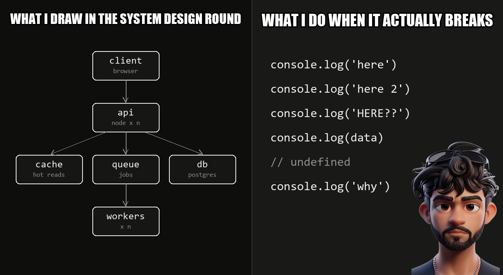

<a href="https://manas-portfolio-pnrg.vercel.app/"></a>

<p align="center">
  <b><a href="https://manas-portfolio-pnrg.vercel.app/">portfolio</a></b> &nbsp;·&nbsp;
  <a href="https://manas-portfolio-pnrg.vercel.app/resume/Manas_Kapoor_Resume.pdf">résumé</a> &nbsp;·&nbsp;
  <a href="https://www.linkedin.com/in/manas-kapoor-5075b9347/">linkedin</a> &nbsp;·&nbsp;
  <a href="https://leetcode.com/u/MANAS50/">leetcode</a> &nbsp;·&nbsp;
  <a href="mailto:manaskapoor033@gmail.com">email</a>
</p>


### hey, i'm manas

I write backend code, mostly Node, and I think way too much about what happens when a thousand people hit the same endpoint at once.

CS undergrad at HPTU Hamirpur, graduating 2029. I learn by building things and then watching them fall over.

**what i'm up to:**

- building **EdgeCase**, a contest platform that has to be fair to everyone, even the guy who disputes every verdict
- doing **e-Yantra** for my college, which is teaching me that hardware has no `Ctrl+Z`
- losing rating in LeetCode contests, in C++, on purpose, apparently
- **looking for a backend internship.** yes, that's why this README is trying so hard

<br clear="right">

### stuff i've built

| | what it is | the honest part |
|---|---|---|
| **Chaitanya 2K26**<br>[live](https://chaitanyahptu.dev) | Official site for HPTU's tech and cultural fest. 21 events, 2 workshops. I led the tech team. | You can't push back a fest date with a Jira comment. |
| **EdgeCase**<br>[live](https://edge-case-competitive-programming-w-sage.vercel.app) · [code](https://github.com/Manas756/Edge-Case-Competitive-Programming-website) | ICPC-style contest platform. Signed sessions, sandboxed judging with Judge0, penalty scoring. | Hidden tests never leave the server. Your WA stays between you and the judge. |
| **ROG**<br>[code](https://github.com/Manas756/Rog-The-Ai-Assistant) | Voice assistant for Windows that runs Whisper locally. Say "start LeetCode mode" and it opens LeetCode and YouTube Music. | Speech maps to a fixed list of actions and never touches a shell directly. I'd like to keep my PC. |
| **ShatranjX**<br>[live](https://shatranjx-com-master-the-game.onrender.com/) · [code](https://github.com/Manas756/ShatranjX.com-Master-The-Game) | Real-time chess with Socket.io, Chess.js and Stockfish. | The server is the referee, so no, your pawn can't go there. |
| **CamPulse**<br>[live](https://campus-speed-run.vercel.app/) · [code](https://github.com/Manas756/CamPlus) | Hackathon build. Anonymous campus complaints, with an AI risk score so hazards rise above routine requests. | Ignore a complaint for 72 hours and it goes to your boss. Also, I've spelled this project five different ways across my own links. Naming things is hard. |

<p align="center">
  
</p>

### open source, the honest scoreboard

- **merged:** [apache/doris-website#3581](https://github.com/apache/doris-website/pull/3581). Fixed a logo getting clipped in the navbar. Yes, Apache. Yes, a logo. It counts.
- **open:** [accordproject/template-archive#966](https://github.com/accordproject/template-archive/pull/966), archiving template instances in `cicero-core`
- **open:** [aboutcode-org/www.aboutcode.org#175](https://github.com/aboutcode-org/www.aboutcode.org/pull/175), an About page
- **closed:** [apache/doris-website#3630](https://github.com/apache/doris-website/pull/3630). We don't talk about #3630.

### the part for your résumé filter

- **1st of 25 teams** at a tech-fest hackathon, as team lead
- Led hackathon teams at **Adobe Hackathon, Colosseum, Mock SIH** and **Smart India Hackathon**
- **Technical Team Lead**, Chaitanya 2K26
- **Web Developer Intern**, InAmigos Foundation (Jun–Jul 2026)
- **C++ Mastery Workshop** certification, IIT Delhi

### what i build with

No skill bars, because nobody knows what "80% React" means.

```yaml
backend:   Node.js, Express, Socket.io, REST APIs
frontend:  React, Next.js, Tailwind, GSAP, Framer Motion, Three.js
data:      PostgreSQL, MongoDB, MySQL
languages: C++, JavaScript, TypeScript
tools:     Git, GitHub, Linux
```

### my status codes

```http
200 OK                   tests passed. touching nothing. going home.
304 Not Modified         my sleep schedule
400 Bad Request          "bas 5 minute aur"
403 Forbidden            pushing to main on a friday
429 Too Many Requests    me, resubmitting in a contest with 2 minutes left
503 Service Unavailable  me, the day after a hackathon
```

### receipts

<p align="center">
  <a href="https://leetcode.com/u/MANAS50/"></a>
</p>

---

<p align="center">
  <b>hiring backend interns?</b> <a href="mailto:manaskapoor033@gmail.com">send me an email</a>.<br>
  <b>found a bug in my code?</b> that's a feature. also email.<br><br>
  
</p>

<!-- reading the raw markdown? you'd catch things in code review. let's talk: manaskapoor033@gmail.com -->
